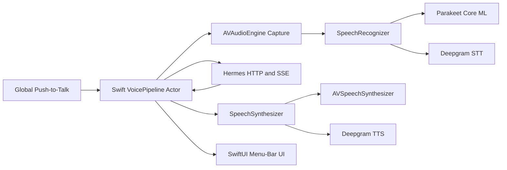

# J.A.R.V.I.S. Native macOS Voice Assistant Plan

## Context

J.A.R.V.I.S. will make Hermes Agent immediately accessible on Apple Silicon macOS without requiring a terminal. The first usable version is a lightweight menu-bar application with a true global push-to-talk hotkey, local speech, optional Deepgram speech, and the same Hermes tools, approvals, sessions, and memory used by its other interfaces.

The architecture has intentionally pivoted away from Electron, React, Pipecat, Voice UI Kit, WebRTC, Python services, and speech-helper IPC. Those technologies are useful for cross-platform or server-hosted voice products, but they add processes, serialization, permissions, memory use, and packaging complexity to a single-user macOS assistant.

The existing local STT stack is already native:

- Swift/Core ML package: `/Users/sender/Downloads/Flowtype/local_parakeet`
- API: `ParakeetTranscriber.transcribe(samples:)`
- Input: complete mono `Float` buffers at 16 kHz
- Model cache: `~/Library/Caches/com.parakeet-tdt/hf-models/mweinbach1_parakeet-tdt-0.6b-v3-coreml`

Local Parakeet initially produces final utterance transcripts rather than artificial streaming partials.

## Architectural Decision

Build a **fully native Swift macOS application**.

- **SwiftUI `MenuBarExtra` + AppKit where needed**: menu-bar lifecycle, popover, settings, approvals, diagnostics, and launch-at-login.
- **Carbon global hotkey events**: true key-down/key-up push-to-talk without depending on an Electron shortcut toggle.
- **AVAudioEngine**: direct microphone capture and conversion to 16 kHz mono floating-point samples.
- **Parakeet Core ML in-process**: load the model once and transcribe without a subprocess or IPC boundary.
- **Hermes HTTP/SSE through URLSession**: reasoning, tools, approvals, sessions, cancellation, and memory.
- **AVSpeechSynthesizer**: direct native playback and immediate cancellation.
- **Deepgram through native HTTP/WebSocket clients**: optional cloud STT/TTS in later phases.
- **Swift actors and protocols**: turn orchestration, cancellation, stale-generation rejection, routing, and testability.

Pipecat and Voice UI Kit are not part of macOS v1. The native service protocols remain modular so a future Pipecat backend can be added for browser, phone, remote, or multi-user channels without replacing the app.



## Project Layout

```text
apps/macos/
├── Package.swift
├── Sources/
│   ├── JarvisCore/
│   │   ├── Audio/                 AVAudioEngine capture and conversion
│   │   ├── Hermes/                URLSession API/SSE client and event models
│   │   ├── Hotkey/                Carbon global hotkey service
│   │   ├── Speech/                Recognizer/synthesizer protocols and providers
│   │   ├── AppConfig.swift
│   │   ├── VoicePipeline.swift
│   │   └── VoiceState.swift
│   └── JarvisApp/
│       ├── JarvisApp.swift
│       ├── AppModel.swift
│       └── AssistantPopover.swift
└── Tests/JarvisCoreTests/

docs/                             Architecture, Hermes API, privacy, packaging
scripts/                          Native build and focused checks
```

For the signed release, move from the SwiftPM development executable to an Xcode macOS application target while retaining `JarvisCore` as the tested package/library.

## Core Contracts

### Voice State Machine

The `VoicePipeline` actor owns all turn state:

```text
idle
→ listening
→ transcribing
→ thinking
→ tool / approval
→ speaking
→ idle
```

`interrupting`, `degraded`, and `error` are explicit states. Every turn has a monotonically increasing generation. Results and Hermes events are accepted only when their run ID and generation still match the active turn.

### Audio Capture

`AudioCapturing` provides:

- microphone authorization status;
- `start()` for key-down;
- `stop()` returning one utterance as 16 kHz mono `[Float]`;
- `cancel()` for sleep, shutdown, or failed turns.

`AVAudioEngine` keeps capture inside the app process. Conversion uses `AVAudioConverter`; device-native sample rate and channel layout must not leak into the recognizer contract.

### Speech Recognition

```swift
protocol SpeechRecognizing: Sendable {
    func prepare() async throws
    func transcribe(samples: [Float]) async throws -> SpeechTranscript
}
```

- `ParakeetRecognizer` lazily loads and retains one Core ML transcriber.
- `DeepgramRecognizer` is added later behind the same contract.
- Local STT returns a final transcript only until real incremental inference is proven.

### Speech Synthesis

```swift
protocol SpeechSynthesizing: Sendable {
    func speak(_ text: String, contextID: UUID) async throws
    func stop(contextID: UUID?) async
}
```

`MacSpeechSynthesizer` uses native playback directly. It does not generate PCM for a local transport because there is no WebRTC or sidecar. Hermes deltas are buffered at conservative sentence boundaries before speech; barge-in calls `stopSpeaking(at: .immediate)`.

### Hermes Client

Use the installed Hermes HTTP API:

- `GET /health`
- `GET /v1/capabilities`
- `POST /v1/runs`
- `GET /v1/runs/{run_id}`
- `GET /v1/runs/{run_id}/events`
- `POST /v1/runs/{run_id}/approval`
- `POST /v1/runs/{run_id}/stop`
- session/history endpoints as required

`HermesClient` uses `URLSession` and an incremental SSE parser. It forwards:

- `message.delta`
- `tool.started` / `tool.completed`
- `reasoning.available`
- `approval.request` / `approval.responded`
- `run.completed` / `run.failed` / `run.cancelled`

Use `X-Hermes-Session-Id` for conversation continuity and a random installation UUID in `X-Hermes-Session-Key` for long-term memory scope. Secrets are read from Keychain, never `UserDefaults` or logs.

Tool approval requires an explicit UI action in v1; spoken approval is out of scope.

### Provider Modes and Privacy

- `local`: Parakeet + macOS TTS only. No Deepgram client is created.
- `cloud`: Deepgram STT/TTS only; failures remain visible.
- `auto`: local-first and may use cloud only with explicit consent and configured credentials.

Do not race local and cloud requests or resend an utterance after an ambiguous timeout. Provider selection is fixed at turn start. Local speech does not imply local Hermes reasoning; the UI and documentation must disclose Hermes model routing separately.

## Barge-In Sequence

When the hotkey is pressed while Hermes or TTS is active:

1. Increment the active generation immediately.
2. Stop `AVSpeechSynthesizer` playback.
3. Cancel sentence buffering and pending speech tasks.
4. Call Hermes `/v1/runs/{run_id}/stop` asynchronously.
5. Dismiss approvals belonging to the interrupted run.
6. Start a new `AVAudioEngine` capture immediately without waiting for Hermes.
7. Ignore all late STT, Hermes, tool, approval, and TTS events from the old generation.
8. On key release, stop capture and begin the new local transcription.

App termination is separate: stop capture and speech, request active run cancellation, persist safe state, and exit cleanly.

## Implementation Phases

### Phase 0 — Native Contract Foundation

1. Replace the Electron/Python workspace with a Swift package containing `JarvisCore` and a SwiftUI menu-bar executable.
2. Port Parakeet loading directly into `ParakeetRecognizer`; remove helper IPC.
3. Implement `AVAudioEngine` capture and 16 kHz mono conversion.
4. Implement native macOS synthesis and immediate cancellation.
5. Port the Hermes HTTP client, SSE parser, approval, status, and stop calls to URLSession.
6. Implement a generation-gated `VoicePipeline` actor.
7. Implement Carbon key-down/key-up push-to-talk.
8. Add a minimal menu-bar UI for state, transcript, response, tool status, approvals, and errors.
9. Use synthetic tests for all contracts before running explicit live hardware/model/Hermes checks.

Acceptance criteria:

- The native package builds and focused tests pass.
- No Node, Electron, React, Python, Pipecat, WebRTC, or local IPC process is required.
- The Parakeet instance can remain loaded in-process across turns.
- Late events are rejected after interruption.
- The global hotkey produces distinct press and release callbacks.

### Phase 1 — Complete Local Voice Loop

1. Validate microphone permission and real AVAudioEngine capture.
2. Benchmark Parakeet `.cpu`, `.gpu`, `.ane`, and `.all`; record the measured default.
3. Validate short/noisy/silent utterances and cancellation while inference is running.
4. Validate Hermes health, capabilities, SSE, tools, approvals, sessions, memory, and stop behavior against the installed runtime.
5. Validate `AVSpeechSynthesizer` voice selection and stop latency.
6. Complete the hotkey → capture → Parakeet → Hermes → native TTS loop.
7. Add sentence-safe response chunking for lower perceived latency.

Acceptance criteria:

- No terminal interaction is needed after launching J.A.R.V.I.S.
- Barge-in stops audible speech within 250 ms under normal load.
- A new recording begins without waiting for Hermes cancellation confirmation.
- Ten consecutive local turns reuse the loaded model and preserve session continuity.

### Phase 2 — Provider Routing and Product UI

1. Add native Deepgram STT/TTS adapters.
2. Implement local/cloud/auto routing and negative privacy tests.
3. Add settings for hotkey, model path, compute units, voice, mode, consent, and Hermes endpoint.
4. Store credentials and installation/session keys in Keychain.
5. Add transcript history, tool progress, approval cards, new conversation, diagnostics, and clear error recovery.
6. Add quiet/normal/noisy capture profiles and local latency metrics.

Acceptance criteria:

- Local mode creates no cloud speech client or request.
- Auto fallback is explicit, visible, and attributable.
- Approvals cannot be spoken, duplicated, or applied to stale runs.

### Phase 3 — macOS Reliability

1. Handle sleep/wake, audio-device changes, microphone revocation, Hermes restart, and network changes.
2. Add launch-at-login through `SMAppService`.
3. Add bounded retry/circuit state without silently changing privacy mode.
4. Keep content-free local metrics for capture, STT, Hermes, TTS, and interruption latency.
5. Add bounded logging with transcript/secrets redacted by default.

Acceptance criteria:

- No stale capture, speech, run, or approval survives sleep/wake.
- Audio-device changes recover without restarting the app.
- Local-only remains local through all failure scenarios.

### Phase 4 — Native Packaging

Implementation status: complete. Developer ID/notarization execution and clean-account physical checks require release-owner credentials and hardware state; see `docs/phase-4-status.md`.

1. Create the Xcode application target and bundle `JarvisCore`.
2. Add microphone usage description, hardened runtime, network client entitlement, and required signing settings.
3. Treat Hermes as an external prerequisite for v1 and locate/start its supported API-server command.
4. Detect the existing Parakeet model cache; do not bundle the large model until licensing and installer-size decisions approve it.
5. Archive an Apple Silicon app, sign, notarize, staple, and distribute as DMG/ZIP.
6. Verify Gatekeeper, Keychain, microphone permission, global hotkey, launch-at-login, sleep/wake, and clean-account installation.

Acceptance criteria:

- The signed app launches without Terminal or development paths.
- No background language runtime or helper process is installed.
- Gatekeeper, notarization, and launch-at-login validate on a clean account.

## Security and Lifecycle Rules

- Hermes defaults to a loopback URL; non-loopback endpoints require explicit configuration.
- Store API keys and stable memory identity in macOS Keychain.
- Do not log authorization headers, transcript content, approval commands, or secrets by default.
- Treat all Hermes event fields as untrusted display data.
- Keep one active turn generation and one active Hermes run per voice session.
- Stop capture, speech, and active runs on sleep or termination.
- Never silently route local speech to cloud.

## Dependency Strategy

- Pin the Parakeet Swift package to an immutable revision before release.
- Commit `Package.resolved`.
- Prefer Apple frameworks and avoid third-party dependencies unless they replace substantial, well-defined functionality.
- Use native URLSession instead of an HTTP client dependency.
- Use XCTest/Swift Testing for unit and integration tests.
- Record dependency source, revision, license, and compatibility in `docs/dependency-pins.md`.

## Verification

Automated focused checks:

- Voice state transitions and generation invalidation.
- SSE parsing, run creation, approval, stop, API errors, and unexpected stream closure.
- PCM conversion and utterance buffering.
- Provider routing/privacy matrix.
- Sentence chunking and final flush.
- Hotkey press/release event mapping.
- App model state reconciliation.

Explicit manual checks:

- Microphone permission under the signed app identity.
- Hotkey from another application and macOS Space.
- Real Parakeet benchmark and transcription quality.
- Hermes tools, approvals, memory, session continuation, and cancellation.
- Native voice playback and repeated barge-in.
- Built-in, wired, and Bluetooth devices.
- Sleep/wake and device changes.
- Signed/notarized clean-account installation.

Do not build a separate demo app. Live model inference, Hermes runs, or full app launches occur only as explicit Phase 1 validation steps.

## MVP Completion Criteria

The MVP is complete when an installed Apple Silicon menu-bar app performs the full native Parakeet → Hermes → macOS TTS loop; true push-to-talk works globally; barge-in immediately stops speech and invalidates the old run; tools and explicit approvals appear in native UI; sessions and memory persist; optional cloud speech never runs without authorization; sleep/wake recovers safely; and the signed/notarized app requires no Electron, Node, Python, Pipecat, WebRTC, or development paths.
